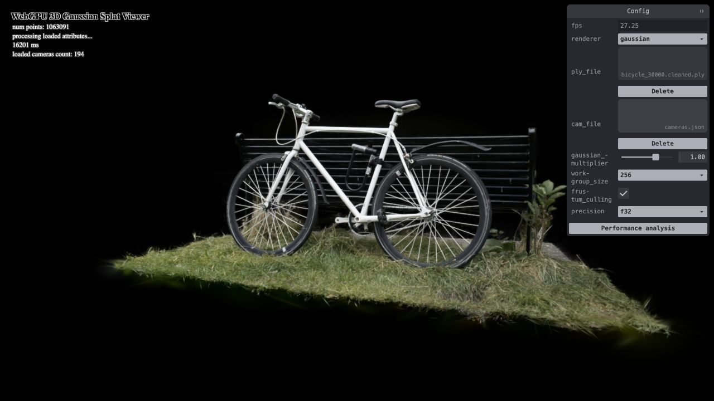
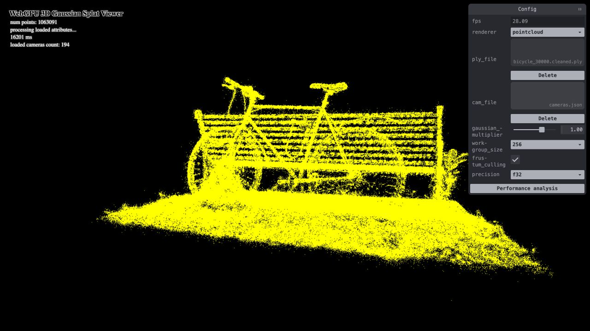
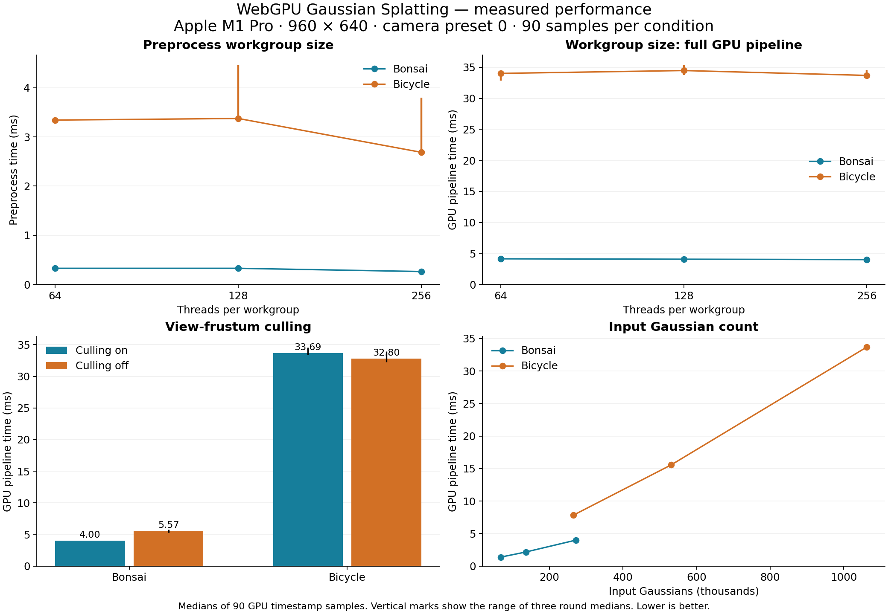
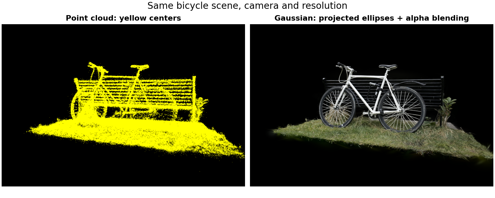
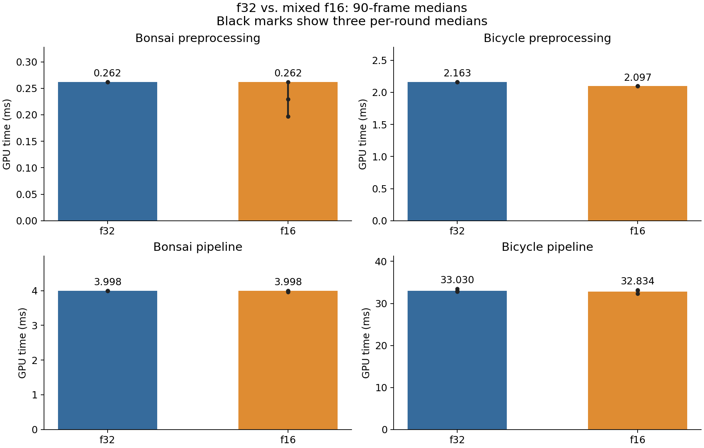
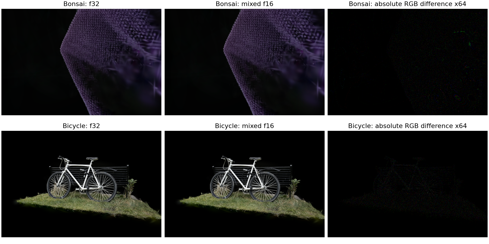

WebGPU Gaussian Splat Viewer
======================
**University of Pennsylvania, CIS 565: GPU Programming and Architecture, Project 5**

* Qingying Li
  * [LinkedIn](https://www.linkedin.com/in/harper-li-292730373/)
* Tested on: a Chromium-based browser (version 155) on macOS 26.5,
  MacBook Pro, Apple M1 Pro (14-core GPU), 16 GB unified memory.

*Bicycle scene, 1,063,091 Gaussians, camera preset 0.*

### Live Demo

TODO: add the GitHub Pages link.

### Demo Video

TODO: add the video link.

### Features

* Point-cloud renderer with the MVP transform.
* Preprocess compute shader: frustum culling, 3D and 2D covariance, conic, splat size, and color from spherical harmonics.
* Depth sorting with the GPU radix sort, then indirect drawing of only the visible splats.
* Fragment shader that fades opacity with the Gaussian falloff, with alpha blending.
* GUI controls for Gaussian scale, preprocess workgroup size (64 / 128 / 256), frustum culling on/off, and f32/f16 precision.
* Extra credit: half-precision (f16) preprocessing.

### Point Cloud vs. Gaussian Splats

| Point cloud | Gaussian splats |
|---|---|
|  |  |

The point cloud draws each Gaussian center as one yellow pixel, so you can see the shape of the scene but there are gaps everywhere. The Gaussian renderer turns each Gaussian into a soft colored ellipse, and the overlapping ellipses blend into the grass, the bike, and the bench.

### How It Works

**Preprocess.** One compute thread handles one Gaussian. It projects the center to NDC and skips it if it is outside a 1.2× screen box or behind the camera. For the rest, it builds the 3D covariance from scale and rotation, projects it to a 2D covariance, and gets the conic and a radius of 3 standard deviations. It also reads the SH coefficients and computes the color for the current view direction. An `atomicAdd` on the visible count gives each kept Gaussian a slot, so the splat buffer only holds visible splats. The same count becomes the instance count of the indirect draw.

**Sort.** The radix sort orders the visible splats by depth so they can be drawn back to front.

**Render.** Each splat is drawn as a quad. The fragment shader uses the conic to compute how far the pixel is from the center and fades the opacity exponentially. Pixels with opacity below 1/255 are discarded. Blending uses premultiplied alpha.

### Controls

| Control | Effect |
|---|---|
| `renderer` | Switch between point cloud and Gaussian |
| `ply_file` / `cam_file` | Load a scene and its `cameras.json` |
| `gaussian_multiplier` | Scale the Gaussians |
| `workgroup_size` | Preprocess workgroup size |
| `frustum_culling` | Turn culling on or off |
| `precision` | f32 or f16 preprocessing (only shows f16 if the GPU supports it) |
| Left drag / right drag / scroll | Rotate / pan / zoom |
| Keys 0–9 | Camera presets |

### Performance Analysis

#### Setup

* Scenes: `bonsai.ply` (272,956 Gaussians) and `bicycle_30000.cleaned.ply` (1,063,091 Gaussians).
* 960 × 640 output, camera preset 0, scale 1.0, SH degree 3.
* For each setting: 10 warmup frames, then 30 timed frames, repeated for 3 rounds (90 frames). The tables show the median.
* "Pipeline" time is GPU time from the start of preprocessing to the end of the render pass, so it includes sorting. It is not FPS.
* The timer on this GPU only ticks every 0.065536 ms, so differences of one tick don't mean much.

Raw data: [Bonsai JSON](performance/results/bonsai.json) · [Bonsai CSV](performance/results/bonsai.csv) · [Bicycle JSON](performance/results/bicycle.json) · [Bicycle CSV](performance/results/bicycle.csv)

#### 1. Point cloud vs. Gaussian renderer

| Scene | Point cloud (ms) | Gaussian (ms) |
|---|---:|---:|
| Bonsai | 0.262 | 3.998 |
| Bicycle | 2.359 | 33.686 |

The Gaussian renderer is about 14–15× slower, but it gives a real image instead of yellow dots. The point cloud only runs one render pass with one point per Gaussian. The Gaussian renderer has to run preprocessing, sort every visible splat, and then shade a whole quad for each splat, and many of these quads overlap on the screen. I think the sorting and the overlapping fragments are where most of the extra time goes.

#### 2. Workgroup size

| Scene | Workgroup size | Preprocess (ms) | Pipeline (ms) |
|---|---:|---:|---:|
| Bonsai | 64 | 0.328 | 4.129 |
| Bonsai | 128 | 0.328 | 4.063 |
| Bonsai | 256 | 0.262 | 3.998 |
| Bicycle | 64 | 3.342 | 34.013 |
| Bicycle | 128 | 3.375 | 34.472 |
| Bicycle | 256 | 2.687 | 33.686 |

256 was the fastest for preprocessing in both scenes (about 20% faster than 64 on Bicycle), so I use it as the default. The total pipeline time barely changes, because the workgroup size only affects preprocessing, and preprocessing is a small part of the frame compared with sorting and drawing. I think bigger workgroups help a little because the GPU has fewer groups to schedule. The shader doesn't use workgroup memory, so there is no data sharing between threads to gain from. The images for 64, 128, and 256 are the same (at most 1/255 difference).

#### 3. View-frustum culling

| Scene | Culling | Gaussians drawn | Pipeline (ms) |
|---|---|---:|---:|
| Bonsai | On | 111,786 | 3.998 |
| Bonsai | Off | 272,956 | 5.571 |
| Bicycle | On | 1,063,091 | 33.686 |
| Bicycle | Off | 1,063,091 | 32.801 |

It depends on the view. In the Bonsai view, the camera is close and culling removes about 60% of the Gaussians, so the frame is **28% faster**. The culled Gaussians skip the covariance and color math, and they also never get sorted or drawn. In the Bicycle view, the whole scene is on screen, so culling removes nothing. The two times are within normal noise, since culling then only adds one extra check.

My culling only tests the Gaussian's center with a 1.2× margin, so a big Gaussian just outside that box can be cut even though part of it should be visible. On Bonsai, this changes some pixels by up to 6/255. It's hard to see, but the image is not exactly the same.

#### 4. Number of Gaussians

To test this, I kept every 4th or every 2nd Gaussian of the same scene.

| Scene | Fraction | Input Gaussians | After culling | Pipeline (ms) |
|---|---|---:|---:|---:|
| Bonsai | 25% | 68,239 | 27,934 | 1.376 |
| Bonsai | 50% | 136,478 | 55,996 | 2.163 |
| Bonsai | 100% | 272,956 | 111,786 | 3.998 |
| Bicycle | 25% | 265,772 | 265,772 | 7.832 |
| Bicycle | 50% | 531,545 | 531,545 | 15.565 |
| Bicycle | 100% | 1,063,091 | 1,063,091 | 33.686 |

Yes. Time goes up roughly linearly with the number of Gaussians: on Bicycle, 4× more Gaussians took about 4.3× longer. Every Gaussian has to be preprocessed and sorted, and more splats also means more overlapping quads to shade. Of course the 25% and 50% images look incomplete, since parts of the scene are missing.

### Extra Credit: f16 Preprocessing

The `precision` option switches to `preprocess-f16.wgsl`, a mixed-precision copy of the preprocess shader.

* **f16:** the SH color math and the quaternion-to-rotation-matrix math. The SH coefficients are already stored as 16-bit floats, so I read them with `bitcast<vec2<f16>>` instead of `unpack2x16float`, which would turn them into f32.
* **f32:** camera transforms, the covariance products, the 2D covariance inverse, and the conic. Squaring small scales and inverting nearly singular matrices can lose too much precision in f16.

`main.ts` only requests `shader-f16` if the adapter supports it. Otherwise the menu only shows f32.

Same setup as above, with culling on and workgroup size 256:

| Scene | f32 preprocess (ms) | f16 preprocess (ms) | f32 pipeline (ms) | f16 pipeline (ms) |
|---|---:|---:|---:|---:|
| Bonsai | 0.262 | 0.262 | 3.998 | 3.998 |
| Bicycle | 2.163 | 2.097 | 33.030 | 32.834 |

f16 made almost no difference. On Bicycle, preprocessing was faster by one timer tick (about 3%), and on Bonsai there was no change. I think the reason is that only part of the preprocessing uses f16, and preprocessing is a small part of the frame compared with sorting and drawing.

The image quality stays basically the same:

| Scene | Mean error (out of 255) | Max error | PSNR (dB) |
|---|---:|---:|---:|
| Bonsai | 0.024 | 2 | 64.3 |
| Bicycle | 0.017 | 2 | 65.7 |

Raw data: [Bonsai JSON](performance/f16/results/bonsai.json) · [Bonsai CSV](performance/f16/results/bonsai.csv) · [Bicycle JSON](performance/f16/results/bicycle.json) · [Bicycle CSV](performance/f16/results/bicycle.csv)

### Changes to the Provided Sorter

With the full scenes, the provided radix sort sometimes gave wrong results or hung, so I changed it:

* The index buffers were smaller than the key buffers. I padded them to the same size.
* I added missing `workgroupBarrier()` calls, and replaced the loop where one workgroup waits for another to finish. Now each pass is three dispatches: per-block histogram, prefix sum, and scatter. Before, a workgroup could wait forever for one that never got scheduled.

All timings above use this fixed sorter.

### Credits

- [Vite](https://vitejs.dev/)
- [tweakpane](https://tweakpane.github.io/docs//v3/monitor-bindings/)
- [stats.js](https://github.com/mrdoob/stats.js)
- [wgpu-matrix](https://github.com/greggman/wgpu-matrix)
- Special Thanks to: Shrek Shao (Google WebGPU team) & [Differential Guassian Renderer](https://github.com/graphdeco-inria/diff-gaussian-rasterization)
- [3D Gaussian Splatting for Real-Time Radiance Field Rendering](https://repo-sam.inria.fr/fungraph/3d-gaussian-splatting/)
